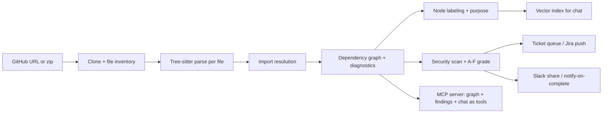

# CodeAtlas — understand any codebase in minutes, not weeks

CodeAtlas is an AI-powered codebase onboarding agent. Paste a GitHub repo URL
(or upload a zip) and get an **interactive dependency graph**, an **AI chat**
grounded in the actual code, and an **automated security scan with A–F grade** —
all in one session. Then push findings to Jira, share to Slack, or let your
editor agent query the repo via **MCP**.

- **Live demo:** run it locally and open `/demo` — watches a real analysis of
  the FastAPI sample repo with staged progress, no signup. Repeat visits reuse
  the cached analysis and load instantly.
- **2-minute video:** not recorded yet — the exact shot-by-shot script is
  [`demo-video-script.md`](./demo-video-script.md) (owner action item).
- **Docs:** `/docs` (quickstart, languages, API, MCP, privacy, FAQ) · **Blog:**
  `/blog` · **Changelog:** `/changelog` · **Architecture deep-dive:**
  `/blog/how-codeatlas-works` · **Agent setup:** `/docs/connect-agent`

## Architecture (mermaid)



Design rule: **static analysis first, LLMs second.** Deterministic answers where
possible (`get_dependency_graph` returns exact edges); honest diagnostics where
not (`unresolved_imports`, `unparsed_files` — never fake zeros).

## Tech stack

| Layer | Tech |
|---|---|
| Frontend | Next.js 16 (static export), React Flow, Tailwind, shadcn/ui, Framer Motion |
| Backend | FastAPI, SQLModel + SQLite, LangChain, ChromaDB, Tree-sitter parsers |
| MCP server | Node + `@modelcontextprotocol/sdk` (stdio + Streamable HTTP) |
| Integrations | Jira Cloud OAuth 2.0 (3LO), Slack OAuth + webhooks, Linear via `linear.new` |
| Quality | pytest (14 tests), GitHub Actions CI, head-tag audit, Plausible (cookieless) |

## Metrics (real numbers only)

Aggregates are computed live from the database — no placeholders anywhere:

- `GET /metrics` → `repos_analyzed`, `analyses_completed`,
  `median_analysis_seconds`, `scans_completed`, `tickets_created`,
  `mcp_keys_active`
- The homepage stats strip (`StatsStrip`) renders exactly what `/metrics`
  returns, including zeros on a fresh deploy.
- Chat turns are intentionally uncounted (no chat persistence server-side).

## Setup (tested from a fresh tree — see verification below)

Prerequisites: Python ≥3.12, Node 20, pnpm, [`uv`](https://docs.astral.sh/uv/).

```bash
# 1. Backend
cd backend
uv sync --group dev          # installs runtime + pytest
uv run pytest tests/ -q      # 56 tests, ~1s
uv run python -m uvicorn app.main:app --port 8000

# 2. Frontend (new terminal)
cd frontend
pnpm install --frozen-lockfile
pnpm dev                     # http://localhost:3000 (API at :8000)

# 3. MCP server (optional — lets Cursor/Claude Code query analyzed repos)
cd mcp-server
npm install && npm run build
npx tsx src/index.ts --repo owner/repo --key <API_KEY_FROM_WORKSPACE_SETTINGS> --stdio
```

Environment: copy `backend/.env.example` to `backend/.env`. All vars, backend
(`SITE_URL`, `DEPLOY_SECRET`, `ASK_RATE_LIMIT_PER_MIN`, `GROQ_API_KEY`,
`CHAT_MODEL_ID` default `openai/gpt-oss-120b`, Jira/Slack/GitHub OAuth IDs) and
frontend build-time (`NEXT_PUBLIC_SITE_URL`, `NEXT_PUBLIC_API_BASE_URL`):
`GROQ_API_KEY` powers chat/scan; Jira/Slack OAuth IDs are needed only when you
use those integrations; `DEPLOY_SECRET` activates the cross-origin mutating-call
guard (empty = fail-open local dev); everything else works without them. The
frontend falls back to `window.location.origin` for the API, which is correct
because one service serves both on Render.

**Verification:** backend (`uv sync --group dev` → pytest 56 passed),
frontend (`pnpm install --frozen-lockfile` → `tsc --noEmit` clean), and
mcp-server (`npm install` → `tsc` build) were each executed against a clean
copy of this tree in `/tmp`. The full `next build` (33 pages) was additionally
run in-tree on identical content. The working tree carries uncommitted changes
on branch `latest-code`; the procedure above is what was validated.

## Repo map

- `backend/` — FastAPI app: routes (`onboard`, `integration`, `jobs`,
  `tickets`, `slack`, `api_keys`, `metrics`), graph parsers, LLM router
- `backend/tests/` — resolver, scoring, severity, API contracts, ask-cache,
  tickets-bulk, API-key crypto, deploy-guard, OAuth state tests
- `frontend/` — Next.js app: 11 routes, workspace (graph/chat/scan/tickets/
  settings), design system in `components/`
- `mcp-server/` — MCP server (stdio + HTTP), 5 tools over real analysis data
- `codeatlas-transform/` — the 00–11 execution pack (dev process docs, not
  shipped; gitignored)
- `demo-video-script.md` — 2-minute video script (owner to record)
- `BLOCKERS.md` — deferred items with reasons (gitignored)
