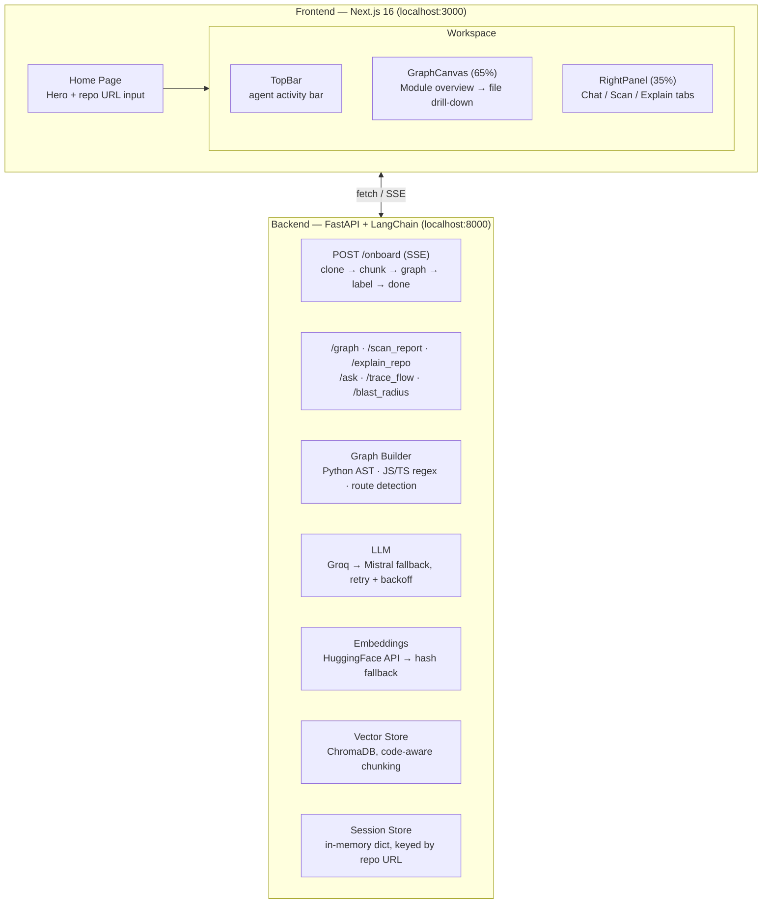

# Repogent

AI-powered codebase onboarding. Paste a GitHub repo URL and get an interactive dependency graph, an AI assistant that understands the code, and an automated security scan — all in minutes.

## Features

- **Dependency graph** — interactive, two-level view (module overview → file-level drill-down) so you're never staring at hundreds of nodes at once
- **AI chat** — RAG-based Q&A grounded in the actual codebase via semantic search
- **Security scan** — heuristic code health report with an A–F grade
- **Execution tracing** — LLM-narrated walkthroughs of how a request flows through the code
- **Blast radius analysis** — see what breaks if you change a given file

## Architecture



## Quick Start

### Prerequisites

- Python 3.11+
- Node.js 20+
- A Groq API key (free tier works)

### Backend

```bash
cd backend
cp .env.example .env    # add GROQ_API_KEY
uv venv && source .venv/bin/activate
uv sync
uvicorn app.main:app --reload --port 8000
```

### Frontend

```bash
cd frontend
npm install
echo "NEXT_PUBLIC_API_BASE_URL=http://localhost:8000" > .env.local
npm run dev
```

Open `http://localhost:3000`, paste a public GitHub URL (e.g. `github.com/psf/requests`), and click **Onboard Repository**.

### Production (single process)

```bash
cd backend
uv venv && source .venv/bin/activate && uv sync
cd ../frontend && npm install && npm run build && cp -r out/* ../backend/static/
cd ../backend
uvicorn app.main:app --host 0.0.0.0 --port 8000
```

The backend serves the built frontend from `static/`, so `http://localhost:8000` serves everything.

## Project Structure

```
backend/
├── app/
│   ├── main.py                  # FastAPI app, CORS, routes, static mount
│   ├── config.py                # pydantic-settings (.env)
│   ├── llm.py                   # Groq/Mistral LLM with retry
│   ├── embeddings.py            # HuggingFace API or hash fallback
│   ├── models/schemas.py        # Pydantic request/response models
│   ├── routes/
│   │   ├── onboard.py           # SSE onboarding (/onboard), QA (/ask), traces
│   │   └── integration.py       # /graph, /scan_report, /explain_repo
│   ├── graph/
│   │   ├── graph_builder.py     # Build dep graph from parsed imports
│   │   ├── python_parser.py     # AST-based Python parser
│   │   ├── js_parser.py         # Regex-based JS/TS parser
│   │   └── blast_radius.py      # Transitive impact analysis
│   ├── ingestion/
│   │   ├── repo_loader.py       # Git clone + file traversal
│   │   ├── chunker.py           # LangChain code-aware chunking
│   │   └── vector_store.py      # ChromaDB build/retrieval
│   ├── chains/                  # LLM chains for labeling, tracing, etc.
│   └── tools/                   # LangChain tools (file, search, scrape)
├── data/
│   ├── chroma_db/                # Persistent vector stores
│   └── repos/                    # Cloned repo temp dirs
├── static/                       # Built frontend (production)
└── requirements.txt

frontend/
├── app/
│   ├── page.tsx                  # Home page (hero + sections)
│   ├── workspace/page.tsx        # Workspace page (graph + panels)
│   └── globals.css               # Tailwind v4 + shadcn + theme
├── components/
│   ├── hero.tsx                  # URL/upload input with example repo buttons
│   ├── processing-screen.tsx     # SSE progress modal
│   ├── site-header.tsx / site-footer.tsx
│   ├── how-it-works.tsx / features.tsx / live-preview.tsx
│   └── codeatlas/
│       ├── workspace.tsx         # Layout: TopBar + GraphCanvas + RightPanel
│       ├── top-bar.tsx           # Header + agent activity bar
│       ├── graph/
│       │   ├── graph-canvas.tsx  # Interactive React Flow graph (~1350 lines)
│       │   ├── node-popover.tsx  # File details popover on click
│       │   └── tech-stack-strip.tsx
│       └── panel/
│           ├── right-panel.tsx   # Tabbed chat/scan/explain panel
│           ├── chat-tab.tsx      # AI chat with RAG
│           ├── scan-tab.tsx      # Security scan with export (JSON/CSV/TXT/PDF)
│           └── explain-tab.tsx   # Repo summary cards
└── lib/codeatlas/
    ├── types.ts                  # TypeScript interfaces
    ├── api.ts                    # Session-aware API wrappers
    ├── context.tsx                # React context + global store
    └── client.ts                  # HTTP client + SSE reader + graph mapper
```

## API Endpoints

| Method | Path            | Description                                    |
|--------|-----------------|-------------------------------------------------|
| GET    | `/health`       | Health check                                    |
| POST   | `/onboard`      | SSE stream — clone, chunk, graph, label, return |
| POST   | `/graph`        | Get stored dependency graph                     |
| POST   | `/scan_report`  | Code health scan (grade, metrics, issues)       |
| POST   | `/explain_repo` | 5 summary bullet points about the repo          |
| POST   | `/ask`          | RAG-based Q&A with vector search                |
| POST   | `/trace_flow`   | LLM-narrated forward execution trace            |
| POST   | `/start_here`   | Goal-guided reading path through the graph      |
| POST   | `/blast_radius` | Transitive dependency impact (BFS depth ≤ 10)   |
| POST   | `/explain_file` | LLM one-paragraph file explanation              |

## Key Design Decisions

| Decision                  | Rationale                                                                                   |
|----------------------------|-----------------------------------------------------------------------------------------------|
| SSE for onboarding          | Real-time progress feedback during the multi-step pipeline (clone → chunk → graph → label)   |
| Groq + Mistral fallback     | Groq is fast with a generous free tier; Mistral catches auth/rate-limit failures transparently |
| Simple embedding fallback   | SHA-256 hash-based embeddings need zero dependencies or API calls when HuggingFace is unavailable |
| Two-level graph             | Module overview (circular) → focus drill-down (grid) avoids overwhelming users with hundreds of nodes |
| In-memory session store     | No database needed; sessions are ephemeral, keyed by repo URL                                |
| Hash-based route matching   | Python uses AST; JS uses regex — simpler but less robust for complex patterns                |
| Heuristic health scan       | File-count ratios + regex pattern matching (not a full SAST tool) — lightweight, O(1) per file |
| Single binary deploy        | Backend serves the built frontend as static files; one `uvicorn` process runs everything      |

## Tech Stack

**Backend:** FastAPI, LangChain, Groq, Mistral, ChromaDB, GitPython
**Frontend:** Next.js 16, React 19, React Flow (`@xyflow/react`), Tailwind CSS v4, Framer Motion
